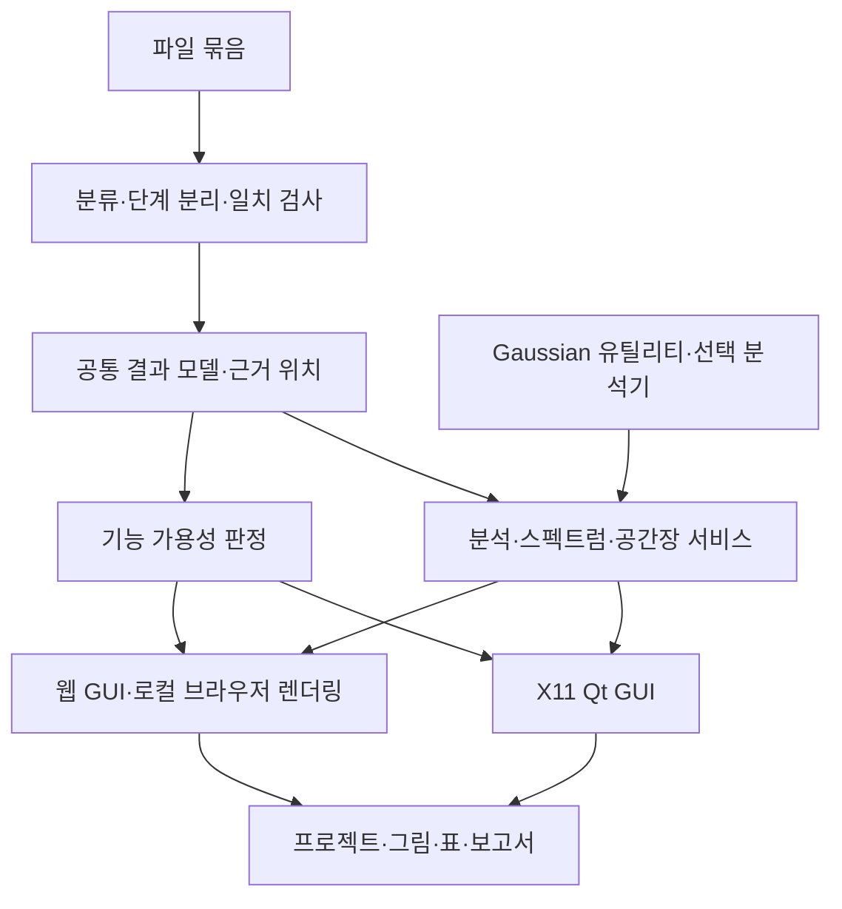

# Gaussian 16 Analysis Studio 구축 기획서

기준일: 2026-11-10 (한국 시간) · 문서 버전: 기획 1.0 · 상태: 프로그램 구현 전

## 1. 목표와 조사 범위

Gaussian 16 결과를 GaussView처럼 읽고 시각적으로 분석하는 프로그램을 구축한다. 동일한 분석 엔진에 ① MobaXterm SSH X11용 Linux GUI와 ② SSH 터널을 통해 현재 PC의 브라우저에서 사용하는 웹 GUI를 연결한다. 이번 산출물은 기능 명세, 데이터 요건, 설계, 개발 순서와 검증 기준이다. 프로그램 코드, 실행 가능한 시제품, Gaussian 계산은 작성·실행하지 않았다.

조사 기준은 Gaussian이 배포하는 **GaussView 6 공식 참조 매뉴얼**이다. 공식 PDF 332쪽의 목차, 결과 분석 장, 입력 설정 장, 파일 형식 장, 메뉴·아이콘 표와 관련 상세 설명을 대조했다. PDF의 생성·수정 메타데이터는 2019년이며, 검색 서비스가 표시하는 최근 수집일은 문서 개정일로 취급하지 않았다. GaussView 6 계열을 기준으로 한 문서 기반 목록이며, 특정 설치본의 모든 패치 차이를 실행 대조한 인증 목록은 아니다. 개발 착수 시 보유한 GaussView의 정확한 버전과 Gaussian 16 revision을 기준선으로 고정한다. [G01]

공식 기능을 아래 **140개 구현 단위**로 묶었다. 같은 기능의 메뉴·도구막대·단축키는 하나로 묶고, 기능 내부의 색·선폭·재생 속도 같은 옵션은 해당 행에 포함했다. Gaussian의 모든 계산 키워드를 별개의 GUI 기능으로 세지는 않는다. 공식 GUI에도 사용자 정의 키워드·추가 입력 통로가 있으므로 이를 보존하는 방식으로 범위를 잡았다. GMMX·AMPAC은 기본 기능과 구별한 선택 연동이다. [G01]

근거의 역할은 다음과 같다. 공식 매뉴얼과 Gaussian 기술 문서를 지원 범위·과학적 정의의 기준으로 삼고, Gaussian, Inc. 유튜브의 공개 설명·목차·시간표시로 실제 사용 흐름을 교차 확인했다. 영상 전체를 재생해 검증했다는 의미는 아니다. 커뮤니티의 직접 질문과 대학 HPC 운영 문서는 실패 사례와 환경 조건을 찾는 데 사용했다. 오래된 커뮤니티 답변을 Gaussian 16의 규칙으로 일반화하지 않았다. [G02-G09, C01-C04]

**권고 결정:** 결과 분석을 첫 제품으로 완성한 뒤 분자 편집·입력 생성·작업 제출을 추가한다. 공통 데이터 모델, 파일 조합 검증, 단위 변환과 기능 가용성 판정을 먼저 설계해야 두 GUI에서 같은 수치를 보장할 수 있다.

## 2. 입력 파일에 따른 기능 가용성

| 확보한 파일 | 가능한 기능 | 추가로 확인할 조건 |
|---|---|---|
| `.log` / `.out` | 구조, 출력된 에너지·전하·진동수·열화학·전자전이, 최적화/IRC/scan 경로 | 실제 출력한 항목만 가능. 인쇄 정밀도와 중간 구조 생략에 제한이 있다. |
| `.chk` | 저장된 파동함수·구조·미분량의 원천 | 바이너리 형식이다. 호환되는 Gaussian 설치의 `formchk`로 변환하고 성공 여부를 확인한다. |
| `.fchk` / `.fch` | 구조, 기저·MO 계수·밀도, 저장된 Hessian·응답 데이터 | 파일 존재가 해당 데이터의 존재를 보장하지 않는다. 레코드별 가용성을 검사한다. |
| `.cube` / `.cub` | 저장된 공간장의 등치면·단면·속성 매핑 | 이 파일만으로 에너지 수렴·전체 MO 목록·진동 분석을 복원할 수 없다. |
| `.com` / `.gjf` | 입력 조건, 초기 구조, Link1 설정, 추가 입력 | 계산 결과가 아니다. 실행 결과와 연결해 비교한다. |
| 진동·분광·PCM 등 부가 출력 | 비조화·vibronic·용매 공동 등의 고급 결과 | 계산 옵션에 따라 로그·체크포인트·별도 파일에 나뉜다. 실제 결과 파일 묶음으로 확인한다. |

권장 보관 묶음은 **입력 + 전체 로그 + 원본 chk + 호환 변환된 fchk**다. 자주 쓰는 cube, 선택한 데이터 세트와 표시 설정도 함께 보관한다. `.log`와 `.chk` 두 개로 많은 분석을 시작할 수 있지만, 수행하지 않은 Raman·NMR·TD·응답 계산의 결과까지 생기는 것은 아니다. MO 계수가 상세 인쇄된 특수한 로그는 오비탈 재구성에 사용할 수도 있지만 기본 경로는 fchk로 정한다. [G01, G06-G08]

## 3. 전체 구조와 사용자 흐름

### 3.1 공통 엔진과 두 화면

1. 파일을 추가하면 입력·로그·chk·fchk·cube의 후보 관계를 찾는다. 파일명은 후보 생성에만 쓰고 원자·좌표·전하·기저·상태 정보로 실제 연결을 확인한다.
2. 한 로그를 개별 계산으로 나누고 그 안에 최적화 단계, SCF 반복, 진동 분석, 여기 상태 등을 계층적으로 구성한다. Gaussian 내부의 Link 번호와 사용자가 연결한 Link1 작업을 구별한다.
3. 각 결과에 원본 파일 해시, 바이트/행 위치, 계산 단계, 구조 식별자, 단위, 파서 버전과 가용성 상태를 붙인다.
4. 구조·개요부터 먼저 표시하고 진동·궤적·MO·공간장은 필요할 때 읽는다. 큐 작업은 화면을 멈추지 않고 진행률·취소를 제공한다.
5. 표의 행, 스펙트럼 피크, 경로의 점을 선택하면 해당 구조·진동 모드·오비탈을 동시에 선택한다.
6. 저장 시 원시 결과와 사용자의 후처리 설정을 분리한다. 다시 열면 같은 수치·선택·시점이 재현된다.

### 3.2 공통 결과 모델

| 객체 | 필수 정보와 설계 규칙 |
|---|---|
| Project / Source | 원본 경로, 해시, 크기·수정 시각, parser·utility 버전. 외부 경로가 바뀌어도 해시로 복구한다. |
| Calculation | 작업 유형, method/basis/ECP, 용매, 전하·다중도, 대상 전자 상태, 종료·수렴 상태, 부모 작업 |
| Geometry / Frame | 원소·동위원소·좌표·안정된 atom ID, 원본 원자번호, 좌표계, 시간/반응좌표/scan 값 |
| EnergyRecord | SCF/MPn/CC/ONIOM/복합법/여기 상태 등 에너지 종류, 값·단위·구조·단계. 단일 final_energy 필드로 덮어쓰지 않는다. |
| Property / Spectrum | 원자·결합·분자 속성, tensor 축·단위; 원시 stick와 broadening·scaling 설정을 별도 저장 |
| OrbitalSet / Field | canonical/NBO/NTO 등 종류, spin, 점유·에너지·기저 순서; 공간장 원점·3축 벡터·차원·단위·밀도 종류 |
| Analysis / Scene | 계산식, 파라미터, 입력 해시, 결과 버전; 카메라·등치값·색범위·클리핑·선택 상태 |
| Capability / Task | 사용 가능/생성 가능/추가 계산 필요/외부 도구 없음/형식 미지원/손상; 실행·취소·실패·재시도 상태 |

결과가 없는 경우 0으로 표시하지 않고 이유와 다음 조치를 표시한다. 예: “Raman activity가 출력되지 않았습니다”, “Hessian이 없어 동위원소 재분석을 수행할 수 없습니다”, “이 chk와 로그의 최종 구조가 다릅니다”.

## 4. 공식 기능 목록과 구현 조건

표의 우선순위는 **P1 결과 분석 기반**, **P2 고급 분석**, **P3 편집·입력·실행**, **P4 선택 연동**이다. 공식 기능명·범위를 기준으로 정리했으며, 데이터·구현·정상 작동 조건 열은 본 프로그램을 위해 설계한 요구사항이다. 각 행은 계획이며 현재 구현 완료를 뜻하지 않는다. `L=log/out`, `F=fchk/fch`, `K=chk`, `C=cube`, `I=입력`, `M=분자 모델`, `U=Gaussian 유틸리티`로 줄여 쓴다. 개별 기능의 계산 전제는 5장에서 보완한다.

### 4.1 파일과 프로젝트: 15개

근거: 공식 매뉴얼 인쇄 쪽 4-8, 81, 183-201, 209, 224. [G01]

| ID·우선 | 공식 기능 | 데이터 | 구현·정상 작동 조건 |
|---|---|---|---|
| I01·P1 | Gaussian 입력 읽기 | I | Cartesian/Z-matrix, 변수·추가 입력과 Link1을 읽는다. 알 수 없는 절은 원문으로 유지하고 왕복 저장을 검사한다. |
| I02·P1 | 로그·출력 읽기 | L | 중도 종료·잘린 로그도 부분 결과를 연다. 출력 중인 마지막 미완성 레코드는 보류한다. |
| I03·P1 | 바이너리 checkpoint 열기 | K, U | 호환 `formchk`를 작업 복사본에 실행한다. 반환 코드·출력 파일·필수 레코드를 모두 확인한다. |
| I04·P1 | formatted checkpoint 열기 | F | 레코드 길이, 자료형·배열 수, Fortran D 지수와 선택 레코드를 검사한다. |
| I05·P1 | cube 열기 | C | 다중 공간장·MO cube, 비직교 격자, 원점·축·단위를 해석한다. 데이터 수와 격자 크기를 대조한다. |
| I06·P2 | Gaussian frequency 파일 열기 | `.gfrq` | 공식 예제·설치본 표본으로 형식을 검증한다. 일반 로그로 임의 해석하지 않는다. |
| I07·P3 | PDB·AMBER PDB 읽기 | PDB | 물 포함 여부, 잔기 결합 규칙·chain 정보를 옵션화한다. 누락 원자·다중 모델을 구별한다. |
| I08·P3 | MOL·SDF·RXN 읽기 | 구조 파일 | 다중 분자와 반응의 양쪽을 보존한다. 금속·비표준 원자가를 자동 수리해 원문을 바꾸지 않는다. |
| I09·P3 | MOL2/ML2 읽기 | 구조 파일 | 결합·atom type·전하·lone pair 변환 정책을 분리하고 변환 손실을 기록한다. |
| I10·P3 | CIF 읽기 | 결정 파일 | 격자·분율 좌표·공간군과 점유율을 보존한다. disorder는 명시적인 선택을 요구한다. |
| I11·P4 | GMMX·AMPAC 계열 파일 | 선택 형식 | 표본과 형식 명세가 확보된 형식만 adapter로 지원한다. 이름만 인식한 상태와 완전 지원을 구별한다. |
| I12·P1 | 여러 작업 중 선택해 열기 | I, L | 첫/마지막/선택/전체 작업을 지원한다. 선택하지 않은 계산도 원본에서 삭제하지 않는다. |
| I13·P1 | 중간 구조·결합 읽기 옵션 | L, F | 최종만/전체, bond table/거리 추정, weak bond 정책을 분리한다. 경로 프레임을 빠뜨리지 않는다. |
| I14·P1 | 분자 그룹·연관 파일·새로고침 | 파일 묶음 | 그룹 추가/교체/append, 최근 파일, 관련 파일, refresh를 제공한다. 새로고침 후 선택을 안정된 ID로 복구한다. |
| I15·P3 | 저장·일괄 형식 변환 | M, I | 공식 변환 범위는 Gaussian/AMPAC 입력·MOL/SDF·GMMX·MOL2 등이다. 형식별 손실을 표시하고 무손실을 가정하지 않는다. |

### 4.2 구조 표시와 선택: 14개

근거: 인쇄 쪽 4-9, 33-42, 146-151, 227, 245-252. [G01, G02]

| ID·우선 | 공식 기능 | 데이터 | 구현·정상 작동 조건 |
|---|---|---|---|
| V01·P1 | 회전·이동·확대, 정밀 배향 | M | 카메라 변환을 원자 좌표와 분리한다. 마우스 동작 중 원본 구조가 변하지 않아야 한다. |
| V02·P1 | wire/tube/ball-and-stick/CPK | M | 표시 반경과 실제 결합 길이를 구별한다. 두 GUI에서 같은 선택·색·크기 설정을 사용한다. |
| V03·P1 | 원소·번호·값 라벨 | M, 속성 | 원자번호는 원본 기준을 보존한다. 라벨 겹침·한글·고해상도 배율을 검사한다. |
| V04·P1 | 수소·dummy·결합 표시 제어 | M | 숨기기는 삭제와 분리한다. dummy center와 ghost atom을 같은 의미로 처리하지 않는다. |
| V05·P1 | 거리·각·이면각 조회 | M | 원자 2/3/4개 선택과 수치 패널을 연결한다. 공선점·0 길이에서는 정의 불가를 표시한다. |
| V06·P1 | 여러 독립 view | M | 같은 모델을 여러 카메라로 표시한다. 표시 설정과 구조 편집의 공유 범위를 구별한다. |
| V07·P2 | molecule group multiview·동기화 | 여러 M | 바둑판·독립/동기 회전·크기·활성 모델 전환을 지원한다. 대량 view는 보이는 항목만 렌더링한다. |
| V08·P1 | 클릭·박스·brush 선택 | M | 보이는 면만/가려진 원자 포함 선택을 명시한다. 드래그 회전과 선택 동작을 충돌시키지 않는다. |
| V09·P2 | 조건·거리·연결성 기반 선택 | M | 원소/번호/MM/ONIOM 필터, 결합·주변 거리 확장, 전체·해제를 지원한다. |
| V10·P3 | PDB 잔기·chain·secondary structure 선택 | PDB | 실제 잔기 메타데이터에 연결한다. 단순 XYZ에는 없는 정보를 만들어내지 않는다. |
| V11·P2 | 이름 있는 원자 그룹·선택 유지 | M | 그룹은 안정된 atom ID 집합으로 저장한다. 원자 삭제·재배열 후 dangling reference를 정리한다. |
| V12·P2 | 입체화학 R/S 표시 | 연결성 있는 M | bond order·동위원소·CIP 판정 조건을 검사한다. 불확실한 금속·결합성에는 미판정 상태를 허용한다. |
| V13·P2 | fog·배경·축·원근·클리핑·품질 | M, Scene | depth와 Z-clip을 지원하고 속도·품질을 조정한다. 투명체 겹침과 그래픽 fallback을 검증한다. |
| V14·P1 | 강조·숨기기·중심맞춤·표시 색상 | M, Scene | 선택·강조·숨김을 별도 상태로 관리한다. 원소색과 속성색 간 전환을 되돌릴 수 있게 한다. |

### 4.3 분자 작성과 편집: 23개

근거: 인쇄 쪽 12-33, 152-172, 181-182, 225-227, 234-235. 원본 계산 결과를 편집하면 새 모델을 만들고 기존 결과 연결을 해제하는 것이 본 프로그램의 추가 설계 규칙이다. [G01]

| ID·우선 | 공식 기능 | 데이터 | 구현·정상 작동 조건 |
|---|---|---|---|
| B01·P3 | 원자·원소 템플릿 배치 | M | 원자가·결합 방향을 확인한다. 금속 착물은 유기분자 규칙을 강제로 적용하지 않는다. |
| B02·P3 | ring·functional-group 라이브러리 | fragment | 부착 원자·제거 원자·방향을 메타데이터로 보관한다. fragment 저작물은 자체 제작/허용 자료를 사용한다. |
| B03·P3 | 아미노산·nucleoside 템플릿 | fragment | 말단·중간 형태와 연결 위치를 구별하고 입체화학을 유지한다. |
| B04·P3 | 사용자 fragment 라이브러리 | fragment | 가져오기·추가·분류·검색·삭제를 제공한다. 구조 형식·버전과 부착점 유효성을 검사한다. |
| B05·P3 | fragment 결합·배치 방식 | M | 교체/부착·방향·자동 수소·부분 clean 정책을 분리하고 충돌을 사전 확인한다. |
| B06·P3 | fragment를 선택 원자 centroid에 배치 | M | 기하학적 중심을 사용한다. 질량중심과 선택 옵션을 혼동하지 않는다. |
| B07·P3 | 수소·valence 추가·삭제 | M | 전체/선택 적용, 전하·결합차수와 원자가를 대조한다. 원자 ID와 그룹을 갱신한다. |
| B08·P3 | 결합차수·길이 편집·SmartSlide | M | 이동할 연결 성분·고리의 자유도를 판정한다. 고리를 끊지 않고 요청 길이를 만족할 수 있는지 검사한다. |
| B09·P3 | 결합각 편집·SmartSlide | M | 고정할 원자·이동 부분을 명시하고 과도한 변형을 확인한다. |
| B10·P3 | 이면각·Newman projection 편집 | M | 회전축·회전 부분·주기성을 정의한다. 고리 결합은 별도 제약 해법을 사용한다. |
| B11·P3 | 분자 전체 mirror invert | M | 반전 전후 chirality를 대조하고 원본을 보존한다. |
| B12·P3 | 선택 원자 중심 반전 | M | 해당 중심의 연결 치환기를 다룬다. 원자가·인접 구조·입체화학을 검증한다. |
| B13·P3 | Clean 구조 정리 | M | 기하 규칙 또는 선택 힘장으로 정리하되 Gaussian 최적화와 구별한다. 실패한 금속 파라미터를 숨기지 않는다. |
| B14·P3 | Rebond·weak bond 제거·사용자 길이 | M | 거리 기반 표시 결합을 재구성한다. 전자구조 bond order와 별도 자료로 저장한다. |
| B15·P3 | 점군 판정·대칭 증가/감소·제약 | M | 좌표·원소·동위원소와 허용오차를 사용한다. 구조 투영 전후 RMSD를 보여준다. |
| B16·P3 | 원자표·Cartesian/Z-matrix 편집 | M | 수치 유효성·단위·변수 의존성·원자 재번호를 관리한다. 원자 재배열 시 모든 참조를 갱신한다. |
| B17·P3 | Z-matrix 표준화·구조 재배향 | M | 표현 변환과 실제 구조 변경을 구별한다. 거리 행렬 불변성을 확인한다. |
| B18·P3 | 동위원소·여러 isotopologue 정의 | M | 질량과 원소번호를 분리한다. 진동 재계산 전까지 기존 모드와 분리해 표시한다. |
| B19·P3 | MM atom type·전하·ONIOM layer 편집 | M | 원자 속성·link atom·embedding·고정 블록 정보를 유지한다. 방법별 총전하·다중도를 검사한다. |
| B20·P3 | PDB 잔기·chain·구조 메타데이터 편집 | PDB | 메타데이터 수정과 좌표 수정을 구별한다. 내보낼 형식이 보존 가능한 항목을 표시한다. |
| B21·P3 | Redundant Coordinate Editor | M | bond/angle/dihedral 생성·freeze·scan 조건을 입력으로 직렬화한다. Gaussian 원자번호와 일치시킨다. |
| B22·P3 | Connection Editor·QST 원자 대응 | 여러 M | 원소·원자수와 대응표를 검증한다. symmetry 때문에 모호한 매칭은 사용자가 확인한다. |
| B23·P3 | PBC Crystal Editor | cell, M | 1D/2D/3D 주기·공간군·격자·분율 좌표·cell 변환을 지원한다. 분자용 결합 추정과 분리한다. |

### 4.4 입력 작성과 계산 실행: 24개

근거: 인쇄 쪽 43-74, 210-222, 236-240. 입력을 만들 수 있다는 것과 Gaussian 계산을 대체한다는 것은 다르다. 실행은 사용자가 설치한 Gaussian 및 해당 환경의 scheduler를 사용한다. [G01]

| ID·우선 | 공식 기능 | 데이터 | 구현·정상 작동 조건 |
|---|---|---|---|
| J01·P3 | 작업 유형 선택 | M, 설정 | Energy/Opt/Freq/Opt+Freq/IRC/Scan/Stability/NMR와 custom job을 구별한다. 키워드 간 모순을 검사한다. |
| J02·P3 | method·basis·R/U/RO·전하·다중도 | 설정 | 전자수·spin parity, 원소별 basis/ECP 지원을 확인한다. 사용자 정의 method/basis를 보존한다. |
| J03·P3 | 바닥/여기 상태·분산 설정 | 설정 | root·상태 수·함수·분산 조합을 기록한다. 기본값에 의존한 실제 조건도 결과에서 확인한다. |
| J04·P3 | Title·Link 0 설정 | 설정 | mem/nprocshared/chk/oldchk/rwf/Linda 등과 자원 요청을 연결한다. 단위와 파일 덮어쓰기를 검사한다. |
| J05·P3 | 일반 계산 옵션 | 설정 | SCF·symmetry·connectivity·출력 상세도·디스크·Polar·OptRot·CPHF 등을 형식별로 생성한다. |
| J06·P3 | checkpoint 데이터 재사용 | K/F, 설정 | Geom=Check/AllCheck, Guess=Read, force constants를 구별한다. 상태·basis·원자수 호환성을 확인한다. |
| J07·P3 | 초기 guess·mix·localize·fragment | 설정 | guess only/read/fallback/localization·fragment spin을 구별한다. 실행 결과가 추정 MO인지 수렴 MO인지 표시한다. |
| J08·P3 | population·전하·density 옵션 | 설정 | Mulliken/MK/Hirshfeld-CM5/MBS·density source·매 단계 출력을 지원한다. NTO를 전하 분석으로 분류하지 않는다. |
| J09·P3 | NBO/NPA·NLMO/NTO 저장 옵션 | 설정, 외부 NBO | 기본/외부 NBO 버전 지원을 구별한다. canonical MO가 덮어써질 수 있어 별도 checkpoint를 사용한다. |
| J10·P3 | SCRF 용매·모델·추가 입력 | 설정 | PCM/SMD 등 모델과 용매를 직렬화한다. 모델별 필수 추가 입력·유효 반경을 확인한다. |
| J11·P3 | PBC 계산 옵션 | cell, 설정 | translation vector·k점 옵션·분율/Cartesian 변환을 검사한다. 셀 없는 분자에 적용하지 않는다. |
| J12·P3 | 자유 키워드·추가 절·preview | I | 원문 보존·편집·미리보기와 선택적 `testrt` 검증을 제공한다. 통과가 화학적 타당성을 보장하지는 않는다. |
| J13·P3 | QST2/QST3 TS 설정 | 대응된 M | 반응물/생성물/TS 추정 구조의 atom mapping·전하·spin·번호를 일치시킨다. |
| J14·P3 | ONIOM 다층 설정 | M, layer | 각 층 방법·MM·link atom·전하·다중도·고정 블록을 검증한다. 유기 단일층 규칙을 그대로 쓰지 않는다. |
| J15·P3 | CASSCF active space·MO 순열 | MO, 설정 | active 전자/오비탈 수·spin과 순열을 검증한다. MO 편집은 다음 계산의 입력이며 기존 결과 수정이 아니다. |
| J16·P3 | freeze·부분 모드·rigid/relaxed scan | M, 설정 | 좌표 제약과 scan 축·점 수·간격을 정의한다. 실제 자유도와 출력 경로를 대응시킨다. |
| J17·P3 | NMR spin-spin coupling 설정 | M, 설정 | coupling 요청과 shielding만 요청한 경우를 구별한다. tensor 출력 형식을 표본 검증한다. |
| J18·P3 | fragment guess·counterpoise 설정 | M, fragments | fragment별 전하·spin·ghost basis·전체 조합을 검사한다. 보정 전후 에너지 정의를 분리한다. |
| J19·P3 | 이름 있는 calculation scheme | 설정 | 저장·분류·적용·내보내기와 조건 추적을 제공한다. 외부 키워드를 잃지 않고 병합한다. |
| J20·P3 | 분자 그룹 일괄 입력·실행 | 여러 M | 고유 이름·checkpoint·출력 경로를 배정한다. 같은 이름의 chk를 공유하지 않는다. |
| J21·P3 | 로컬 제출·Quick Launch | I, g16 | 임시 디렉터리·환경·진행 상태와 반환 코드를 관리한다. GUI 종료와 작업 생명주기를 분리한다. |
| J22·P3 | Current Jobs·utility 작업 제어 | 실행 task | Gaussian/cubegen/freqchk 진행·오류·취소를 표시한다. 취소 대상을 task ID로 제한한다. |
| J23·P3 | SC Job Manager 형태의 로컬 큐 | 작업 목록 | short/long queue·동시 실행·완료/실패·작업 유형 템플릿을 관리한다. 재시작 후 상태를 복구한다. |
| J24·P3 | 원격 script 실행·로그 stream | scheduler, L | SSH와 SLURM/PBS adapter로 제출·조회한다. 클러스터에서는 로그인 노드 직접 계산을 기본 경로로 삼지 않는다. |

### 4.5 계산 요약과 물성: 10개

근거: 인쇄 쪽 75-81, 141-145. 결과 개요에 보이는 값과 별도 계산해야 하는 값은 구별한다. [G01, G03]

| ID·우선 | 공식 기능 | 데이터 | 구현·정상 작동 조건 |
|---|---|---|---|
| R01·P1 | 계산 개요·조건·구조 정보 | L/F | method/basis·용매·전하·spin·점군을 선택 작업에 연결한다. 파일 내 마지막 값만 일괄 채택하지 않는다. |
| R02·P1 | total energy 표시 | L/F | 방법에 맞는 SCF/MP/CC/ONIOM/복합법/여기 상태 에너지를 선택한다. 전자 에너지와 열보정 포함 값을 구분한다. |
| R03·P1 | 쌍극자 크기·벡터 | L/F | 단위·좌표계를 맞추고 화살표의 길이·원점을 조절한다. 하전계의 원점 의존성을 명시한다. |
| R04·P2 | 분극률 등 분자 물성 요약 | L/F | tensor·평균값·static/dynamic·주파수와 단위를 보존한다. 분자 분극률을 고체 유전율로 표기하지 않는다. |
| R05·P1 | 최적화 수렴 요약 | L | max/RMS force와 displacement, threshold·예측 에너지 변화를 보여준다. 전체 수렴은 Gaussian 판정과 함께 표시한다. |
| R06·P1 | Thermo 요약 | L/F, 진동 분석 | ZPE·thermal E/H/G·S·T/P를 구별한다. correction과 sum을 중복 합산하지 않는다. |
| R07·P1 | imaginary frequency 수 표시 | L/F | 계산된 진동수와 원시 값을 표시한다. 누락된 frequency를 0개의 허수 모드로 처리하지 않는다. |
| R08·P1 | Molecule Group Table | 여러 계산 | 선택한 결과·속성의 정렬·비교·표 편집을 제공한다. 에너지 종류·단위·방법을 열에 함께 표시한다. |
| R09·P1 | 원자 물성·전하의 숫자/색 표시 | L/F | 존재하는 Mulliken·ESP·NPA·Hirshfeld/CM5 등만 활성화한다. 고정/대칭 color range를 지원한다. |
| R10·P2 | 결합 길이·bond order의 숫자/색 표시 | M, L/F | 좌표로 얻은 길이와 출력된 결합차수를 구분한다. 표시용 연결성의 single/double을 양자화학 결합차수로 오인하지 않게 한다. |

### 4.6 최적화·반응 경로·궤적: 7개

근거: 인쇄 쪽 82-106. [G01, G03]

| ID·우선 | 공식 기능 | 데이터 | 구현·정상 작동 조건 |
|---|---|---|---|
| T01·P1 | Optimization 에너지·gradient plot | L | 최적화 step과 내부 SCF iteration을 분리한다. 선택 점을 해당 좌표와 연결한다. |
| T02·P1 | IRC plot·구조 보기 | L, 경로 데이터 | forward/reverse·반응좌표·에너지·구조를 분리해 읽고 공통 TS를 중복 처리하지 않는다. |
| T03·P1 | 1변수 PES scan | L, scan 설정 | rigid/relaxed를 구별하고 각 점의 내부 최적화 최종값을 연결한다. 실패한 점은 빈 값으로 남긴다. |
| T04·P2 | 2변수 scan 3D surface | L, 두 좌표 | 축 단위·순서·반복점을 검사한다. 미계산 영역은 보간 결과로 명확히 표시한다. |
| T05·P2 | BOMD·ADMP·trajectory plot | L/trajectory | 실제 time step·온도·에너지와 구조를 동기화한다. 재시작 시 시간·프레임 중복을 정리한다. |
| T06·P2 | conformer energy plot | conformer 집합 | 상대 에너지 기준·단위·동일 방법을 표시한다. GMMX 결과 읽기와 검색 실행을 분리한다. |
| T07·P1 | 구조 연속 재생·속성 추가 plot | frame 집합 | forward/reverse/loop·재생 간격과 거리·각·물성 시계열을 연결한다. 저장 프레임 사이 보간은 표시용임을 명시한다. |

### 4.7 MO·공간장·표면: 16개

근거: 인쇄 쪽 132-140, 173-176. Gaussian 공식 영상은 cube 생성→surface→contour→mapped surface 순서와 용매 공동 표시를 안내한다. [G01, G04]

| ID·우선 | 공식 기능 | 데이터 | 구현·정상 작동 조건 |
|---|---|---|---|
| O01·P1 | MO 에너지·점유 diagram | L/F | HOMO/LUMO·점유·대칭·degeneracy threshold와 energy/occupancy 순서를 표시한다. 0/1 기반 번호를 구별한다. |
| O02·P1 | 특정 MO·여러 MO 등치면 | F, U 또는 C | 선택 오비탈의 ψ를 공간장으로 만든다. ±위상과 같은 등치값·격자로 비교한다. |
| O03·P1 | alpha/beta 오비탈 구별 | open-shell F/C | spin 채널별 MO 수·에너지·점유를 읽는다. open-shell의 frontier를 단일 쌍으로 축약하지 않는다. |
| O04·P3 | MO 점유·charge/spin·순열 편집 | MO 집합 | 다음 Gaussian 작업용 설정으로 저장한다. 기존 파동함수의 결과와 섞지 않고 Aufbau/원본 복원을 제공한다. |
| O05·P3 | 기존 MO 불러오기·guess-only 생성 | K/F, Gaussian | 추정 MO 생성·localization 조건을 기록한다. 수렴된 SCF 결과와 시각적으로 구별한다. |
| O06·P2 | 저장된 NBO·NLMO·NTO 등 보기 | 적합한 F/C | 오비탈 종류·상태·점유/가중치 출처를 붙인다. canonical MO로 오표기하지 않는다. |
| O07·P1 | total/alpha/beta electron density | F, U 또는 C | SCF/상관 밀도·full/frozen core 가용성을 검사한다. 수치 적분을 해당 전자수 정의와 비교한다. |
| O08·P1 | electrostatic potential | F, U 또는 C | 핵·전자 기여와 밀도 종류를 확인한다. 전하 점근사와 파동함수 ESP를 구별한다. |
| O09·P2 | spin density | F, U 또는 C | alpha-beta 밀도를 사용한다. 총밀도와 구별하고 부호·전자수 차 적분을 확인한다. |
| O10·P2 | NMR shielding·자기 관련 공간장 | 해당 응답 데이터, U/C | 성분·외부장 방향·대상 핵과 필요한 응답 결과를 확인한다. NMR isotropic 값 하나로 공간장을 만들지 않는다. |
| O11·P1 | cube 생성·load/save/remove·격자 | F/C, U | 범위·원점·해상도·메모리 추정과 비동기 생성·취소·캐시를 제공한다. 외부 파일 삭제와 화면 제거를 구별한다. |
| O12·P2 | cube scale/square/add/subtract | C | 같은 구조·좌표계·격자를 우선 요구한다. 재격자가 필요하면 보간법·오차를 기록한다. |
| O13·P1 | solid/transparent/mesh·±surface | C | marching cubes 등으로 mesh를 만들고 등치값·부호·가림·Z-clip을 조절한다. 값 범위 밖 등치값을 설명한다. |
| O14·P1 | 다른 물성으로 surface 색칠 | 두 공간장 | density 표면 위 ESP 등 mesh vertex에서 두 번째 장을 샘플링한다. 좌표·단위·색상 범위를 고정해 비교한다. |
| O15·P2 | 2D contour·평면 정의·이동 | C | 3점/원점+법선으로 평면을 정의하고 보간한다. 공선 3점·범위 밖 평면을 검사한다. |
| O16·P2 | PCM solvation cavity | PrintSpheres 등 출력 | 공식 매뉴얼의 SCRF=Read 추가 입력 PrintSpheres 자료를 읽는다. 일반 vdW 표면으로 대체해 PCM이라 부르지 않는다. |

### 4.8 진동과 분광: 19개

근거: 인쇄 쪽 107-131. IR/Raman/VCD/ROA, 동위원소 치환, ORD/NMR 흐름은 공식 영상의 공개 목차와도 일치한다. [G01, G05]

| ID·우선 | 공식 기능 | 데이터 | 구현·정상 작동 조건 |
|---|---|---|---|
| S01·P1 | 진동수·모드 선택·애니메이션 | L/F의 모드 | Cartesian 변위와 질량가중 모드를 구별한다. 주기·진폭·재생 속도를 실제 동역학 시간과 구별한다. |
| S02·P1 | 변위·dipole derivative 벡터 | 모드, 해당 미분량 | 좌표 변환 시 벡터도 함께 회전한다. IR intensity만으로 dipole derivative 방향을 복원하지 않는다. |
| S03·P1 | 모드 방향 수동 변위·구조 저장 | 구조+모드 | ±진폭 좌표를 새 구조로 생성한다. 허수 모드 변위가 반응 경로를 증명하지는 않는다. |
| S04·P1 | 주파수 scale factor | 진동수+설정 | 원래 값과 표시용 값을 보관한다. 열화학 재계산 scale과 plot scale을 분리한다. |
| S05·P1 | IR 스펙트럼 | ν, IR intensity | stick와 Gaussian/Lorentz broadening을 제공한다. 단위·FWHM/HWHM·정규화 규칙을 명시한다. |
| S06·P1 | Raman 스펙트럼 | ν, Raman activity | activity와 intensity를 구별한다. 레이저·온도·편광 조건을 적용하고 계산 근거를 저장한다. |
| S07·P2 | VCD 스펙트럼 | ν, 회전강도 | 부호와 단위·선폭을 보존한다. enantiomer 변환의 부호 관계로 확인한다. |
| S08·P2 | ROA 스펙트럼 | ROA 응답 결과 | 산란 기하·레이저 주파수·단위·편광 조건을 선택한다. Raman activity만으로 생성하지 않는다. |
| S09·P2 | 주파수 의존 결과 선택 | 여러 응답 주파수 | 계산된 incident frequency별 데이터를 연결한다. 계산하지 않은 주파수는 재계산 필요로 표시한다. |
| S10·P2 | isotope 치환 후 모드·스펙트럼 비교 | Hessian, 질량 | freqchk 또는 검증된 질량가중 Hessian 해법으로 재분석한다. 기존 모드 번호가 그대로 대응한다고 가정하지 않는다. |
| S11·P2 | FreqChk·모드 선택/저장 | K/F, U | 미분량·온도·압력·scale·선택 모드를 명시적으로 전달하고 구버전 기본 scale에 의존하지 않는다. chk 쓰기는 복사본에서만 수행한다. |
| S12·P2 | 비조화·overtone·combination 표시 | anharmonic 출력 | harmonic·fundamental·overtone·조합 피크를 분리한다. harmonic 주파수 배율만으로 비조화 결과를 만들지 않는다. |
| S13·P1 | NMR shielding·기준물질 chemical shift | NMR 출력, reference | 핵종별 shielding·δ와 기준 계산 조건을 보존한다. degeneracy tolerance·선폭·summary export를 제공한다. |
| S14·P1 | UV-Vis 스펙트럼·전이 | 여기 상태 에너지·f | eV/nm/cm-1 변환과 선폭·전이 목록을 연결한다. oscillator strength 없이 정량 흡광도를 주장하지 않는다. |
| S15·P2 | ECD 스펙트럼 | 전자전이 회전강도 | length/velocity gauge 등 출처와 부호를 보존한다. UV oscillator strength로 대신 계산하지 않는다. |
| S16·P2 | ORD plot | 파장별 optical rotation | 계산된 파장·specific/molar rotation 정의와 용매 조건을 표시한다. 파장 0 또는 공명 부근 보간을 검사한다. |
| S17·P2 | Vibronic OPA·Duschinsky·전이표 | vibronic 결과 | 초기/최종 상태·모드 매핑·온도와 행렬·보고된 전이를 읽는다. TD 전이 목록만으로 재구성하지 않는다. |
| S18·P2 | Mixture Editor·conformer 평균 | 여러 스펙트럼, 가중치 | 수동 비율·Boltzmann 평균을 지원한다. 에너지/자유에너지·T·degeneracy와 스펙트럼 단위를 일치시킨다. |
| S19·P1 | plot 겹치기·축·선·피크·라벨 편집 | Spectrum/plot | 확대·반전·범위·선폭·색·폰트·sticks/curve를 지원한다. 원시 데이터는 표시 편집과 분리한다. |

### 4.9 출력과 환경 설정: 10개

근거: 인쇄 쪽 89-106, 129-131, 202-208, 223-233, 242-267. 파일 형식은 각 설치본의 지원 범위를 확정한 뒤 지원표에 고정한다. [G01, G02]

| ID·우선 | 공식 기능 | 데이터 | 구현·정상 작동 조건 |
|---|---|---|---|
| P01·P1 | plot·스펙트럼 수치 데이터 내보내기 | 원시/가공 배열 | stick·곡선·미분·NMR summary, 범위·격자 간격을 구별한다. 열 이름·단위·설정을 함께 저장한다. |
| P02·P1 | 구조·plot 이미지 저장 | Scene | PNG/JPEG/TIFF/EPS 등 공식 대응 형식의 특성을 구분한다. 벡터 plot과 raster 3D 이미지의 차이를 알린다. |
| P03·P2 | 임의 크기·해상도·그룹 이미지 | Scene 집합 | 배경·흑백/색상·batch 이름·해상도·카메라를 고정한다. 라벨과 색상막대가 잘리지 않아야 한다. |
| P04·P1 | 진동·구조 movie와 frame 저장 | animation | MP4/GIF/MNG 계열·개별 프레임의 지원을 명시한다. 프레임 수·방향·반복·끝점 지연을 설정한다. |
| P05·P2 | 인쇄·clipboard image capture | Scene/plot | OS 의존 기능은 desktop에서 제공한다. 웹은 다운로드·인쇄와 대응 기능으로 제공한다. |
| P06·P1 | 폰트·색·크기·창·디렉터리 설정 | preferences | 한글/영문 fallback·DPI·아이콘·파일 연결을 관리한다. 브라우저와 서버 파일 경로를 혼동하지 않는다. |
| P07·P3 | toolbar 구성·빠른 실행 배치 | preferences | action ID에 단축키·도구막대를 연결한다. 동일 action이 메뉴와 다른 결과를 내지 않게 한다. |
| P08·P2 | 그림·movie·진동·결합·clean 기본값 | preferences | 사용자 기본값과 프로젝트 값을 구별하고 초기화·schema migration을 제공한다. |
| P09·P2 | 창·view·그룹 관리 | view 상태 | 닫기/숨기기/복원·tile/cascade·이전/다음·활성 그룹을 제공한다. 웹은 tab/dock/grid로 대응한다. |
| P10·P1 | 도움말·문맥 도움·tips·버전 정보 | 자체 도움말 | 공식 개념에 링크하고 자체 UI 도움말을 작성한다. 네트워크 없이 기본 설명·지원 버전을 볼 수 있게 한다. |

### 4.10 선택 패키지 연동: 2개

근거: 인쇄 쪽 177-180, 281-292 및 공식 제품 소개에서 선택 패키지로 안내하는 범위. [G01, G10]

| ID·우선 | 공식 기능 | 데이터 | 구현·정상 작동 조건 |
|---|---|---|---|
| A01·P4 | GMMX conformer search 연동 | 별도 GMMX | force field·energy window·탐색 설정, 결과 읽기·후속 계산을 연결한다. RDKit/CREST 대안은 GMMX와 다른 검색기로 표시한다. |
| A02·P4 | AMPAC interface 연동 | 별도 AMPAC | 실행 환경·입출력 형식·버전이 확보될 때 adapter를 작성한다. 기본 배포에서 필수 의존성으로 삼지 않는다. |

## 5. 결과를 잘못 해석하지 않기 위한 상세 요건

### 5.1 종료·SCF·최적화·진동 안정성은 별개의 판정

정상 종료, SCF 수렴, 기하 최적화 수렴, stationary point 분류, 파동함수 안정성, TS 연결성은 별도 상태로 저장한다. `Normal termination` 하나로 “올바른 최저에너지 구조”를 표시하면 안 된다. 링크된 Opt+Freq+SP에서는 Opt가 끝났어도 Freq가 실패할 수 있고, 정상 종료한 단일점에는 최적화 수렴이라는 개념을 적용하지 않는다.

최적화 임계값은 해당 계산에서 읽고, Gaussian의 완료/중단 문구 및 실제 마지막 최적화 단계와 함께 평가한다. 처음 four YES가 보이는 위치를 전체 계산의 최종 결과로 채택하지 않는다. 특정 최적화 알고리즘·제약 조건에는 추가 판정 정보가 필요할 수 있다.

진동수 검토는 완전 Hessian을 가진 비선형 자유 분자라면 3N-6, 선형 분자라면 3N-5를 기준으로 모드 수를 확인한다. 단원자·동결 원자·부분 Hessian·주기계·선택 모드 계산은 별도 규칙을 쓴다. 출력의 `Low frequencies`와 회전·병진 투영 이후 normal-mode 진동수를 혼합하지 않는다. [G09]

정지점 판정에는 최적화와 frequency의 방법·기저·전자 상태·용매 조건이 일치하는지도 확인한다. 낮은 수준의 최적화·진동수에 높은 수준의 단일점 에너지를 더하는 열화학 근사는 별도로 허용할 수 있지만, 그 진동수가 높은 수준의 potential energy surface에서도 최소점·TS임을 증명하지는 않는다.

모든 유효 진동 모드가 양수이면 최소점의 증거가 되고, 하나의 유효 음의 곡률이면 1차 saddle의 증거가 된다. 하나의 imaginary frequency가 곧 의도한 반응의 TS임을 보장하지 않는다. 모드의 원자 움직임과 양방향 IRC 끝점의 최적화·반응물/생성물 대응을 확인한다. 작은 음수를 보편적인 cutoff 하나로 자동 제거하지 않는다. 원래 값·사용자 경고 기준·constraint·gradient·적분격자와 판정 근거를 함께 제시한다. [G09]

### 5.2 에너지·단위·열화학

에너지는 “마지막 SCF Done” 검색으로 끝내지 않는다. MP2/CC/복합법·ONIOM·여기 상태의 최종 에너지는 다른 레코드에 있을 수 있다. SCF·상관 에너지·분산 보정·PCM 항·ZPE·G를 종류별로 보관하고, 이미 포함된 항을 중복 가산하지 않는다. 선택한 방법과 단계에 맞는 값을 우선 표시하고 사용자가 그 근거를 열 수 있게 한다.

cclib는 여러 전자 에너지와 MO 에너지를 eV로, enthalpy/freeenergy를 Hartree로 제공하는 등 속성별 단위가 다르다. 내부 표준 단위를 정하고 adapter 경계에서 변환해야 한다. 예를 들어 로그·fchk·cclib 값이 모두 같은 단위라고 가정하는 구현은 금지한다. [D01]

기본 열화학은 Gaussian이 보고한 RRHO 값의 재현이 우선이다. ZPE, thermal correction, electronic+thermal sum, 온도·압력·동위원소·회전 대칭수·spin을 구별한다. 용매 모델로 전자 에너지를 구했다고 해서 병진 엔트로피가 자동으로 용액의 표준상태로 보정된 것은 아니다. 후처리 모델은 원래 결과와 별도 저장한다. [G08]

### 5.3 구조와 원자 대응

Gaussian input orientation, standard orientation, fchk 좌표를 자동 연결할 때 강체 정렬과 atom mapping을 사용한다. 좌표만 회전한 경우 dipole은 Rμ, tensor는 RαRᵀ처럼 함께 변환한다. 하전계에서는 쌍극자의 원점 변환도 필요하다. 대칭 원자가 많은 구조는 좌표·원소 일치만으로 mapping이 유일하지 않을 수 있다.

구조를 편집하면 “계산 결과 구조”를 덮어쓰지 않고 새 모델을 만든다. 원자 수·결합·좌표가 바뀌었는데 예전 에너지·진동·오비탈이 새 구조의 결과인 것처럼 남아 있는 상태를 방지한다. 표시상의 rebond는 계산된 전자 밀도나 bond order를 변경하지 않는다.

### 5.4 chk·fchk·cube와 오비탈

기본 경로는 **원본 chk 보존 → 안정된 복사본 → 호환 formchk → fchk 레코드 검사 → cubegen → cube 검사 → mesh/contour**다. Linux에서 계산한 chk를 다른 OS에서 직접 해석할 수 있다고 가정하지 않는다. 생성한 시스템 또는 호환 환경에서 fchk로 바꾸는 경로를 제공한다. 특정 CPU 코어에서만 변환된다는 식의 오래된 커뮤니티 주장은 구현 규칙으로 채택하지 않는다. [G06-G07, C02-C03]

아직 기록 중인 chk는 완결성을 보장할 수 없다. 크기·수정 시각의 짧은 안정 확인은 보조 수단일 뿐이고, 가능한 경우 작업 완료 또는 안전한 snapshot 후 변환한다. 실패하면 기존 정상 캐시를 유지하고 부분 로그 분석은 계속 제공한다.

직접 AO→MO 계산을 구현할 경우 pure/cartesian d/f, sp shell, 기저 함수 순서·정규화·ECP·alpha/beta·fractional occupation을 모두 맞춰야 한다. 첫 버전은 Gaussian `cubegen`을 우선 사용하고 독자 오비탈 계산기는 나중에 검증된 선택 adapter로 추가한다. cclib로 계수를 읽는 것만으로 모든 종류의 오비탈 공간장이 검증되는 것은 아니다. [G07, D01]

cube는 원점·3개 격자 벡터·정수 차원·단위·축 순서·여러 field를 포함하는 공간 데이터다. 모든 cube를 단위 Å의 직교 격자로 간주하지 않는다. 읽기 후 실제 값 개수와 header를 맞추고, 등치값이 데이터 min/max를 교차하는지 확인한다. density 공간장을 전자수로 적분할 때에는 voxel 부피·Bohr/Å 변환·full/frozen core·ECP 전자수 정의를 함께 확인한다. [G07]

서로 다른 구조를 정렬한 후 density를 빼는 것은 좌표 변환·보간을 포함하는 정의된 분석이다. 고정 구조의 fragment density difference와 구조가 다른 두 결과의 단순 차를 구별한다. MO의 전체 부호는 임의이므로 ψ 부호 색상만으로 서로 다른 계산의 전자 이동을 해석하지 않는다.

### 5.5 진동·분광의 생성 원리

| 결과 | 원리 | 필수 구현 조건 |
|---|---|---|
| 모드 재생 | x(t)=x₀+Aq sin(θ) | q의 정규화·질량가중 여부를 확인한다. 허수 모드 재생은 saddle 방향의 시각적 변위이며 안정된 실제 진동이 아니다. |
| IR | 진동수 νᵢ와 intensity Iᵢ를 선모양으로 broadening | raw stick·scale·선폭 정의·축 단위·정규화 여부를 보존한다. |
| Raman | 대표적인 Stokes 상대강도는 Sᵢ(ν₀-νᵢ)⁴/[νᵢ{1-exp(-hcνᵢ/kBT)}]에 비례 [D10] | ν₀>νᵢ, 같은 파수 단위, activity·편광·온도를 확인한다. 절대강도에는 추가 상수·정의가 필요하다. |
| isotope 재분석 | Hmw=M^(-1/2) H M^(-1/2) 고유문제와 회전·병진 투영 | Hessian·질량·평형 구조가 필요하다. H→D라고 모든 ν에 1/√2를 곱하지 않는다. [G09] |
| NMR | 통상 ppm 근사로 δ≈σref-σsample | 핵종·계산수준·용매·온도·기준물질을 맞춘다. J coupling multiplet simulation은 별도 추가 기능이다. |
| UV-Vis/ECD | 전이 에너지·강도를 energy/wavenumber 축에서 broadening | nm로 축을 바꿀 때 물리량이 축상의 함수인지 단위 구간당 spectral density인지 정의하고 필요하면 Jacobian을 적용한다. |
| VCD/ROA/ORD | 계산된 회전·응답 성질의 부호와 주파수 의존성을 표시 | IR/Raman 값으로 대체 생성하지 않는다. gauge·산란 기하·응답 주파수를 보존한다. |
| Vibronic | Franck-Condon/Herzberg-Teller 등 요청 모델과 두 전자 상태의 모드 관계 | 사용한 모델·전이표·Duschinsky 결과를 읽는다. 전자전이 sticks만으로 진동 미세구조를 만들어내지 않는다. |

스펙트럼 평균은 동일한 축 정의·온도·intensity 단위로 맞춘 후 수행한다. 서로 다른 conformer 자유에너지의 중복 구조·degeneracy·관측 조건을 확인한다. 그래프 높이를 임의 정규화한 뒤 평균한 결과와 물리적인 가중 평균을 구별한다.

## 6. X11와 웹의 구현 계획

### 6.1 권장 기술과 역할

아래 선택은 문서와 용도에 근거한 **설계 권고**이며 이 환경에서 제작·벤치마크한 결과가 아니다. 정확한 버전 조합은 개발 초기의 호환성 시험 후 고정한다.

| 계층 | 권장 구성 | 선택 이유·확인 사항 |
|---|---|---|
| 공통 데이터·분석 | Python, NumPy/SciPy, typed schema, SQLite + 배열 캐시 | 두 GUI가 같은 함수·데이터를 사용한다. 큰 배열은 JSON으로 반복 전송하지 않는다. |
| Gaussian parser | cclib + 자체 Gaussian 전용 보완 parser | 일반 속성은 재사용하되 Link1·비조화·vibronic·PCM·메서드별 에너지의 지원 공백을 보완한다. [D01] |
| 공식 utility adapter | formchk, cubegen, freqchk, 선택적 cubman/testrt | 사용자 Gaussian 설치를 사용한다. 도움말·버전·오류 형식을 revision별로 확인한다. |
| X11 화면 | PySide6 Qt Widgets | 표·트리·설정·작업 상태를 native widget으로 구성한다. 서버의 Qt xcb 의존성·폰트·DISPLAY를 진단한다. [D04] |
| X11 분자·표면 | VTK/PyVista 계열 후보 + 독립 렌더 worker | 지원되는 환경에서는 직접 렌더링한다. X11 OpenGL이 어려우면 EGL/OSMesa 등 검증된 offscreen 경로에서 이미지를 만들어 Qt에 표시한다. [D03] |
| X11 그래프 | Matplotlib QtAgg 등 | 스펙트럼과 수치 plot을 공통 배열로 그린다. high-DPI·벡터 export를 검증한다. |
| 웹 서버 | FastAPI 계열 + 작업 큐 + WebSocket/SSE | 요청/응답과 장시간 utility 실행을 분리한다. 단일 사용자·서버 로컬 파일 접근부터 시작한다. |
| 웹 분자·표면 | 3Dmol.js | 원자 선택·스타일·cube·사용자 mesh와 화살표 등을 지원한다. 공통 mesh·camera·atom ID를 전달한다. [D02] |
| 웹 plot | Plotly.js 등 | 그래프 점/피크 선택을 viewer와 연결한다. 실제 계산은 공통 backend가 수행한다. |
| 저장·보고 | schema 있는 project 파일, HDF5/Zarr 등 배열 저장 후보 | 원본·파생 배열·표시 설정·분석 근거를 구분한다. 텍스트·표·정적 보고서 내보내기를 제공한다. |

첫 호환성 실험에서 desktop offscreen 경로가 표면·선택·클리핑까지 처리하는지 확인한다. 원자만 보이는 비상 렌더러로 모든 기능을 지원한다고 선언하지 않는다. 3Dmol.js가 담당하기 어려운 특정 표시가 확인되면 해당 부분만 custom mesh 또는 별도 adapter로 처리한다.

PySide6/Qt는 LGPL/GPL 또는 상업 라이선스 선택이 있고, cclib·3Dmol.js는 BSD 계열, GoodVibes는 MIT로 안내되어 있다. 배포 시 선택한 모듈·버전의 조건과 포함된 제3자 고지를 확인한다. Gaussian/GaussView/GMMX/AMPAC 실행 파일이나 공식 fragment 자산을 자체 프로그램에 임의로 묶지 않는다. [D05-D08]

### 6.2 X11 실행과 성능

목표 실행 형태는 “서버에서 프로그램 실행 → MobaXterm X 서버에 native GUI 표시”다. 시작 전 DISPLAY·xauth·Qt xcb·OpenGL renderer·가용 메모리를 간단히 검사한다. MobaXterm의 X11 forwarding과 X server, SSH 서버의 X11 지원이 필요하다. DISPLAY 값을 상수로 덮어쓰지 않는다. 고부하 분석 작업은 별도 프로세스로 보내고 GUI 이벤트를 계속 처리한다. [C01, C04]

원격 X11의 회전 지연을 줄이기 위해 atom/bond·표면 geometry를 재사용하고, 마우스 동작 중 해상도·mesh 수를 줄였다가 정지 후 복구한다. 데이터 파싱·cube 생성·등치면 재생성을 회전 이벤트마다 수행하지 않는다. 렌더 worker가 실패하면 표·로그는 계속 사용할 수 있어야 한다.

Qt WebEngine에 웹 화면을 넣은 것만으로 원격 그래픽 문제가 해결된다고 가정하지 않는다. 그 경우에도 브라우저 엔진은 서버에서 실행되어 X11을 거친다. 실제 로컬 GPU 렌더링의 이점은 아래의 웹 방식에서 얻는다.

### 6.3 웹 실행과 현재 PC 브라우저

목표 실행 형태는 “서버의 127.0.0.1:8888에 서비스 → MobaXterm Local port forwarding → PC의 http://127.0.0.1:8888 접속”이다. 원격 서버에서 `webbrowser.open`에 의존해 Firefox를 띄우지 않는다. 프로그램은 접속 URL과 터널 정보를 표시하고 사용자는 현재 PC의 Chrome/Edge/Firefox로 연다. 서버 포트가 바뀌면 실제 포트와 사용 중인 상태를 분명히 알린다.

웹의 분자 회전·프레임 재생은 PC 브라우저의 WebGL과 GPU에서 수행한다. 파일·계산·cube 생성은 서버에서 처리한다. 초기 전송 후에는 선택·카메라 등 작은 메시지만 교환하고, 큰 궤적은 frame chunk·prefetch, 큰 mesh는 압축·단계별 해상도를 사용한다. 오프라인 사용을 위해 JavaScript·폰트를 배포물에 고정해 포함한다.

서버의 파일 선택과 브라우저의 파일 업로드를 별도 메뉴로 제공한다. 로컬 경로를 서버 경로로 오해하지 않게 한다. 단일 사용자 loopback+SSH 터널을 기본 배포로 삼고, 팀 공유가 필요해질 때 인증·접근 경로·동시 수정 정책을 별도 추가한다.

### 6.4 화면 구성

| 영역 | 내용 |
|---|---|
| 왼쪽 | 프로젝트 → 파일 묶음 → 계산 단계 → 결과 종류 트리, 검색·필터 |
| 중앙 상단 | 작업 진행 상태·취소·선택 계산 정보. 구조 viewer 바로 위에 항상 표시 |
| 중앙 | 구조·오비탈·진동 viewer, 원자 선택·거리·clip·표면 제어 |
| 아래 | 에너지 경로·스펙트럼·MO diagram. 클릭 시 viewer와 동기화 |
| 오른쪽 | 개요/수렴/열화학/속성/선택 항목, 원본 근거 열기 |
| 설정 | 한글·영문 font fallback, 크기·색·DPI, 렌더 품질·캐시·외부 도구 경로 |

TinOxoStudio에서 필요했던 한글·영문 폰트 fallback, 진행 상태의 가시성, 설명을 (?) 도움말로 접는 구성을 반영한다. 회전 중에는 레이아웃·차트·전체 원자표를 다시 만들지 않는다. “한 스크롤 안의 핵심 조작”을 목표로 고급 옵션은 접이식으로 배치한다.

## 7. 추가 기능 제안: 원리와 구현 계획

아래 **16개**는 GaussView 6의 공식 기본 메뉴에서 독립적인 통합 기능으로 확인되지 않았거나, 기존 기능을 자동화·확장하는 제안이다. “GaussView에 전혀 존재하지 않는다”는 단정은 아니다. 기존의 summary·진동 재생·MO 보기·그룹 비교·Boltzmann 평균·cube 뺄셈 자체를 새 기능이라고 세지 않았다. 외부 프로그램이나 후속 버전에는 유사 기능이 있을 수 있다.

### N01. 계산 품질 대시보드 — 최우선

**원리:** 종료·SCF·기하 수렴·잔류 gradient·유효 진동 모드·spin contamination·wavefunction stability·method 적합성의 독립 지표를 규칙 기반으로 묶는다. S(S+1)과 출력된 ⟨S²⟩의 차이는 단서이며 모든 방법에 동일한 합격선을 적용하지 않는다.

**구현:** 각 지표에 통과/주의/실패/해당 없음/미계산 상태와 원문 근거를 둔다. 결과를 “정상 종료했지만 frequency 미수행”, “기하 수렴·imaginary 1개·IRC 미확인”처럼 구체적으로 설명한다. 분류 로직을 계산 유형별로 분리한다. 정상 종료한 saddle·중단된 Opt·안정성 미계산 예제로 오판을 검사한다.

### N02. 기능에 필요한 데이터 안내·파일 불일치 탐지 — 최우선

**원리:** 요청 기능의 prerequisite graph와 파일별 capability를 비교한다. 파일 해시·원자 ID·전하·basis·좌표 정렬·상태 정보로 다른 계산의 파일이 섞였는지 검사한다.

**구현:** “MO 표면: fchk 또는 cube 필요”, “동위원소 재분석: Hessian 필요”처럼 부족한 항목과 생성 경로를 제시한다. 신뢰도가 낮은 자동 매칭은 확정하지 않고 후보로 남긴다. 같은 basename의 다른 구조·다른 root·변경된 chk를 필수 시험에 포함한다.

### N03. TS 검증 작업공간 — P2

**원리:** 모드 움직임에 따라 선택 결합 길이의 변화와 TS±변위를 비교하고, 양방향 IRC 끝점의 구조·결합 변화·에너지를 반응물/생성물에 대응시킨다. 진동수 한 개만으로 TS를 확정하지 않는다.

**구현:** TS·mode·forward/reverse IRC·끝점 Opt/Freq를 한 묶음으로 구성한다. 의도한 bond forming/breaking 선택, mapping·RMSD·연결성 비교, 검증 누락 표시, 후속 입력 생성으로 구성한다. 기존 수동 변위 기능은 재사용한다. 근거가 부족하면 “TS 후보” 상태를 유지한다. [G09]

### N04. 반응 자유에너지·qRRHO 작업공간 — P2

**원리:** 화학양론 νᵢ에 대해 ΔG=ΣνᵢGᵢ를 계산한다. 복합 수준에서는 G≈E_SP+(G_low-E_low)처럼 전자 에너지와 보정을 명시적으로 조합한다. 저주파 보정·온도·농도·표준상태를 모델별로 구분한다.

**구현:** Gaussian 원래 RRHO 결과를 보존하고, 검증된 GoodVibes adapter 또는 동등하게 검증한 후처리기로 qRRHO·표준상태 보정을 별도 생성한다. 1 atm→1 M 보정은 각 종의 RT ln(C°RT/p°) 및 반응의 Δn을 일관된 단위로 처리한다. 용매의 chemical potential 같은 다른 보정과 중복하지 않는다. stoichiometry·spin·용매·온도·SP 매칭을 검사한 뒤 반응 profile과 표를 만든다. [G08, D07]

### N05. 배치 비교의 조건 일치 검사 — P1 확장

**원리:** method·basis/ECP·용매·전하·spin·전자 상태·열화학 모델을 fingerprint로 묶어 비교 가능한 결과를 구분한다. 다른 분자식의 절대 에너지는 안정성 순위로 바로 비교하지 않는다.

**구현:** 그룹 표를 확장해 mismatch 열과 상대 에너지 기준을 제공한다. 동일 조성 conformer 비교와 반응 화학양론 비교를 별도 모드로 둔다. 방법이 섞인 데이터를 자동으로 한 순위에 넣지 않는지 검사한다.

### N06. 오비탈의 연속 추적 — P2

**원리:** 인접 구조의 MO를 에너지 번호가 아니라 AO overlap 또는 정렬된 real-space overlap으로 연결한다. 전체 위상은 overlap 부호로 맞추고, 축퇴·준축퇴 오비탈은 SVD/부분공간 overlap으로 비교한다.

**구현:** 스캔·반응 경로에서 HOMO의 모양이 교체되는 지점을 추적한다. 동일한 spin·기저 조건을 우선 지원하고, 원자 매핑·기저가 달라지면 신뢰도를 낮춘다. crossing·위상 반전·축퇴 예제로 검증한다. 단일 orbital 매칭이 불안정하면 부분공간만 연결한다.

### N07. 여기 상태 NTO·전하이동 정량 패널 — P2

**원리:** 완전한 transition density의 SVD로 hole/particle NTO 쌍과 가중치를 구한다. hole/electron 분포의 중심 거리·공간 중첩·fragment별 전이를 정의된 방식으로 계산한다. 이미 GaussView에서 가능한 NTO 저장·표면 보기 위에 정량 요약을 추가하는 것이다.

**구현:** 초기에는 Gaussian 저장 NTO와 검증된 외부 분석기의 정량 결과를 import한다. 이후 완전한 전이 데이터가 있는 경우에만 자체 계산한다. TD 로그에 출력된 일부 큰 excitation coefficient만으로 정확한 전체 NTO·CT 지표를 주장하지 않는다. TDA/TDDFT 및 spin 형식을 구분하고 Multiwfn 같은 독립 분석기와 비교한다. [D09]

### N08. density difference와 전하 보존 검사 — P2

**원리:** 고정된 좌표·격자에서 Δρ=ρAB-ρA-ρB를 계산하고 적분·fragment 적분을 확인한다. cube 뺄셈 자체는 기존 기능이며, 물리적 조건 검증과 해석 보조를 추가한다.

**구현:** fragment 계산 구조·basis·ghost basis 정책·전자수·spin을 검사하는 마법사를 만든다. 보간이나 다른 구조를 사용한 차분은 별도 분석 유형으로 남긴다. 적분 결과가 기대 전자수 차와 맞지 않으면 격자·범위·정의부터 확인한다.

### N09. 진동 모드 자동 성격 분석 — P2

**원리:** 각 모드를 결합 stretch·angle bend·torsion 같은 내부좌표 방향으로 투영해 상대적 성격을 제시한다. 엄밀한 potential energy distribution은 좌표계·force constant 정의가 추가로 필요하다.

**구현:** 첫 버전은 사용자가 지정한 결합/그룹의 displacement contribution을 표시하고 “정성 기여도”로 명명한다. 이후 검증된 Wilson GF/PED 모듈을 별도 추가한다. 단순 원자 변위 크기를 결합의 정확한 에너지 기여율로 오표기하지 않는다.

### N10. 실험 스펙트럼 비교·제약 있는 fitting — P2

**원리:** 실험 데이터와 계산 스펙트럼을 같은 축·단위로 맞춰 scale factor·line width·conformer 비율을 추정한다. baseline과 instrument broadening을 별도 모델로 둔다.

**구현:** CSV/텍스트 실험 데이터 import, 축 방향·단위 확인, background 처리 기록, 수동/제한 최적화를 제공한다. 비율은 비음수·합 1, 보정 범위는 사용자 설정으로 제약한다. fitting의 해가 구조의 유일한 증명은 아님을 표시한다.

### N11. NMR J-coupling multiplet simulation — P2 이후

**원리:** shielding 기반 chemical shift와 J coupling으로 spin Hamiltonian을 만들고 고유상태 간 허용 전이를 계산한다. 단순 n+1 분열은 first-order 근사에서만 사용한다.

**구현:** 기존 NMR peak plot과 분리된 simulation mode를 만든다. 핵종·spin·장 세기·J·chemical equivalence를 입력받고 작은 spin system부터 검증한다. spin 수 증가에 따른 지수적 비용 제한을 제공한다. J 출력이 없으면 자동 정량 multiplet을 생성하지 않는다.

### N12. 원본 근거·재현 가능한 분석 세션 — P1

**원리:** 모든 파생값을 원본 해시·레코드·수식·설정·버전에 연결한다. 보고서의 한 수치에서 로그 근거와 분석 설정을 다시 열 수 있게 한다.

**구현:** immutable source와 versioned analysis를 분리한다. 원시 stick·scale·line width·isovalue·color range·camera·atom mapping을 프로젝트에 보관한다. 재열기·다른 PC 이전 후 핵심 결과가 같아지는지 확인한다. 공유용 HTML/PDF/표에는 입력 조건과 판정 한계를 포함한다.

### N13. 실행 중 분석·병목 진단·오류별 다음 조치 — P1/P2

**원리:** 로그 추가분을 index하고 SCF 반복 수·최적화 gradient·elapsed time을 시간순으로 추적한다. 흔들림·정체·디스크/메모리/수렴 문제를 유형별로 분류한다.

**구현:** rotation/truncation·재시작·Link1 변경을 감지한다. 오류 설명은 확인된 근거·가능한 원인·후속 입력 제안으로 구성한다. 자동으로 모든 실패에 SCF=QC를 붙이지 않는다. 사용자가 검토한 새 입력으로만 재시작하고 원본은 보존한다.

### N14. 금속·ECP·ONIOM 분석 도우미 — P2

**원리:** 금속 배위·ECP 전자수·spin·layer·link atom·fragment를 함께 표시하면 잘못된 결합 추정·전하 합계 해석을 줄일 수 있다.

**구현:** Sn 옥소 클러스터 같은 예제를 기준으로 metal-ligand 거리/각·전하·spin density·ECP·전체/층별 에너지를 연결한다. 산화수는 계산 전하만으로 확정하지 않고 사용자가 정의한 형식 산화수와 분리한다. ECP·배위 결합을 가진 구조를 초기 시험 집합에 포함한다.

### N15. 분극률·저유전 재료 설계용 export — P2

**원리:** α tensor·평균·비등방성·dipole·분자량·부피 정의 등 분자 지표를 비교한다. 분자 분극률만으로 고분자의 1 GHz 복소 유전율을 결정할 수는 없다.

**구현:** PI 반복단위·리간드별 ML용 표를 내보내고 계산 조건·단위·구조 ID를 필수 열로 둔다. Clausius-Mossotti 추정은 number density와 local-field 가정이 명시된 별도 근사 모듈로만 제공한다. 분자 α(0)를 고체 ε(0) 또는 ε′/ε″(1 GHz)로 자동 표기하지 않는다. 주파수 분산·배향·밀도·이완·흡습은 별도 입력/계산의 대상이다.

### N16. 보관용 패키지·캐시와 원본 구별 — P1

**원리:** 프로젝트 참조 그래프를 따라 재현에 필요한 파일을 수집하고 해시로 무결성을 확인한다. 재생성 가능한 cube/mesh 캐시는 원본 계산 결과와 구별한다.

**구현:** 최소/전체 보관 정책을 제공한다. 전체 로그·입력·fchk·원본 chk·사용한 부가 출력·수동 설정을 포함하며 비밀번호·실행 환경의 비밀값은 넣지 않는다. 캐시만 제거해도 원본이 보존되고, 누락 파일이 있으면 기능별 영향을 알려야 한다.

## 8. 코드 작성을 위한 개발 workflow

### 8.1 착수 전에 확정할 명세

| 산출 명세 | 반드시 포함할 내용 | 완료 판단 |
|---|---|---|
| 기능 추적표 | 140개 ID, 우선순위, 입력, 외부 의존성, 상태, 시험 사례, 두 GUI 대응 | ID별 누락이나 “모든 것 지원”이라는 빈 상태가 없어야 한다. |
| 데이터 schema | Calculation/Frame/Energy/Property/Orbital/Field/Analysis/Source | 여러 작업·좌표계·단위·spin·전자 상태를 잃지 않고 표현한다. |
| parser 지원표 | Gaussian revision·방법·출력 형식별 지원과 알려진 한계 | cclib가 지원하는 항목과 보완 parser가 담당할 항목을 구별한다. |
| capability 규칙 | 기능별 필수 레코드·생성 가능 경로·추가 계산 조건 | 기능 버튼에 활성/비활성 이유와 해결 경로가 연결된다. |
| 서비스 계약 | 계산 ID·구조 ID·단위·task ID·진행/오류·캐시 반환 형식 | X11와 웹이 같은 수치를 반환하는 엔진을 호출한다. |
| 기준 결과 집합 | 원본 입력·출력·checkpoint·기준값·기준 이미지 | 정답의 출처와 정밀도가 명확하다. 민감한 실제 결과 대신 허용된 표본도 사용 가능하다. |
| 화면 동작 명세 | 선택 동기화·탭·단축키·도움말·진행 표시 | 피크/프레임/MO/원자 선택의 대상이 일치한다. |

### 8.2 단계별 구현과 통과 기준

| 단계 | 구현할 내용 | 다음 단계로 넘어갈 조건 |
|---|---|---|
| 0. 기준선 고정 | 보유 Gaussian/GaussView revision, OS·Python·Qt·renderer·scheduler, 표본·정답표 결정 | 라이브러리·utility의 실제 지원과 핵심 parser 형식이 확인된다. |
| 1. 공통 결과 엔진 | 파일 식별·Link1/SCF/Opt 구분·source index·단위·캐시·가용성 | 다중 작업·잘린 로그·fchk 배열을 오류 없이 구별하고 원문 근거가 연결된다. |
| 2. 최소 분석 제품 | 구조·개요·에너지·수렴·전하·열화학·기본 MO diagram·quality 상태 | 동일 입력의 핵심 수치가 두 GUI에서 같고 누락 결과를 0으로 표시하지 않는다. |
| 3. 두 renderer 기반 | Qt 표/그래프·3D 표시·software fallback, 웹 API·WebGL·터널 안내 | 구조 선택·배향·큰 프레임의 비동기 처리가 실환경에서 검증된다. |
| 4. 공간장 | formchk/cubegen adapter·cube parser·±MO·density·ESP·mapped/contour·PCM | 같은 cube·설정으로 수치·표면 bounds·색상범위가 일치하고 잘못된 입력을 설명한다. |
| 5. 진동·스펙트럼 | 모드·IR/Raman/NMR/UV와 이후 VCD/ROA/ECD/ORD·비조화·vibronic | raw stick·변위·축·단위·선폭 정의가 기준 결과와 맞는다. isotope는 별도 재분석으로 통과한다. |
| 6. 경로·고급 분석 | Opt/IRC/scan/trajectory·TS 검증·batch 조건 비교·열화학 보정 | 프레임과 수치 연결, spin·용매·상태를 포함한 비교 조건이 검증된다. |
| 7. 추가 제안 | N01-N16 중 최우선부터, CT·orbital tracking·실험 fitting 순으로 확장 | 각 분석에 가정·입력 완전성·독립 검증 근거가 있다. |
| 8. 분자 편집·입력 | builder·PBC·ONIOM·QST·MO 편집·입력 왕복·scheme | 편집 후 결과 연결을 해제하고 원자 대응·추가 입력·사용자 키워드를 보존한다. |
| 9. 실행·선택 연동 | 로컬 큐·SLURM/PBS·모니터링·GMMX/AMPAC adapter | GUI 종료와 작업 상태를 분리하고 선택 패키지 부재가 기본 분석을 막지 않는다. |
| 10. 배포·재검증 | 설치 진단·offline asset·프로젝트 migration·export·도움말 | 목표 MobaXterm X11/웹 두 환경의 지원표와 재현 가능한 배포 묶음이 완성된다. |

이 순서는 UI만 먼저 완성한 뒤 parser 문제를 뒤늦게 고치는 일을 줄인다. 다만 2-3단계에서 X11의 전체 표면 렌더 가능성을 작게 선검증해야 한다. desktop의 핵심 renderer가 확정되지 않은 상태에서 표면 기능을 대량 구현하지 않는다.

### 8.3 기능 하나를 추가할 때의 반복 workflow

1. 해당 ID의 공식 근거·필수 입력·결과의 물리적 정의를 확인한다.
2. 기준 계산의 원본 파일에서 정답과 정밀도를 정한다. 재계산이 필요하면 별도 계산으로 남긴다.
3. parser와 공통 모델에 값을 저장하고 source 위치·단위를 연결한다.
4. capability 규칙과 부족한 데이터 안내를 작성한다.
5. 공통 service에서 계산하고 worker·캐시·취소 정책을 적용한다.
6. X11/웹의 표시 adapter와 선택 동기화를 붙인다.
7. 수치·과학적 정의·오류 처리·환경별 표시를 기준 결과와 비교한다.
8. 프로젝트 저장·재열기·export 후 결과가 유지되는지 확인한다.

### 8.4 작업 큐와 캐시

캐시 키는 원본 파일 해시 + 계산/구조/상태 ID + 분석 종류 + 단위·파라미터 + parser/utility 버전으로 구성한다. MO index만으로 캐시를 구분하지 않는다. canonical MO를 NTO로 덮어쓴 체크포인트는 다른 OrbitalSet으로 취급한다.

작업 상태는 대기·실행·완료·실패·취소·결과 불완전으로 나눈다. stdout/stderr와 반환 코드·생성 파일을 함께 검사하고 실패한 임시 파일을 정상 캐시로 등록하지 않는다. JSON에 전체 MO 계수나 수백 MB cube를 매번 싣지 않고 배열·mesh 참조를 반환한다. 백그라운드 작업 중에도 viewer 회전과 취소가 반응해야 한다.

## 9. 검증 계획과 완료 기준

아래는 **향후 개발 때 실행할 검증 계획**이다. 현재 사용자 계산 파일이 제공되지 않았고 Gaussian 또는 GaussView와의 실제 수치·영상 동등성 시험도 수행하지 않았다. 기획 단계에서 확인한 것은 문서상 기능 범위·과학적 전제·구현 경로다.

### 9.1 필수 기준 계산 집합

| 표본 | 검증할 핵심 |
|---|---|
| 물·methane Opt+Freq | 닫힌껍질·기본 진동·IR·ZPE·열화학·모드 수 |
| CO2 또는 선형 분자 | 3N-5, 축퇴 모드, 회전·병진 투영 |
| open-shell radical·triplet | alpha/beta MO·spin density·점유·⟨S²⟩ 표시 |
| 1차 TS와 양방향 IRC | 유효 imaginary 1개·모드·endpoint·경로 방향 |
| saddle order>1·작은 음수 사례 | TS 단정 방지·모드 구별·불확실성 표시 |
| 1D/2D relaxed scan | 내부 최적화와 scan 점 분리·실패 점·주기적 축 |
| MP2/CC/ONIOM/복합법 | 마지막 SCF 에너지를 최종 방법의 에너지로 오선택하지 않음 |
| TDDFT/TDA·복수 root | 전이·f·NTO/상태 연결·상태 번호 변경 |
| NMR+기준물질·coupling | ppm·기준 계산 일치·J 정보 유무 |
| Raman/VCD/ROA/ORD | activity/intensity·부호·레이저·응답 주파수 |
| isotope·비조화·vibronic | Hessian·질량·모드 매칭·조합/배음·Duschinsky |
| PCM cavity 출력 | 실제 계산 공동과 일반 분자 표면 구별 |
| Sn/금속+ECP·고각운동량 기저 | ECP 전자수·pure/cartesian shell·비표준 결합 |
| PBC·ONIOM·QST 입력 | 격자·층·원자 대응·추가 입력 왕복 |
| 잘린/이어쓴/여러 작업 로그 | 부분 결과·재시작·정상/비정상 종료 분리 |
| 잘못 조합한 log/chk·다중 cube | 파일 매칭·단위·격자·field 선택·오류 안내 |

### 9.2 수치·시각·과학적 검증을 구분

| 대상 | 권장 통과 기준 |
|---|---|
| 파싱된 에너지·속성 | 원본이 가진 인쇄 정밀도 안에서 일치. 같은 레코드의 직접 파싱은 유효자릿수까지 비교하고 일괄적인 과도한 tolerance를 쓰지 않는다. |
| 좌표·기하값 | 동일 원자 순서·좌표계 또는 검증된 정렬 후 비교. 통상 10^-6 Å 수준은 로그 자릿수가 허용할 때의 목표이며 원본 정밀도에 맞춰 조정한다. |
| 수렴 판정 | 계산 유형별 기준 사례와 상태가 일치하고 Freq 미수행을 허수 0개로 분류하지 않아야 한다. |
| 진동수·열화학 | 표시 자릿수 내 일치. 재분석은 질량·대칭수·T/P·scale·투영 규칙을 같게 맞춰 원인별 오차를 확인한다. |
| MO·density | 동일 cubegen·격자에서는 cube 값·범위가 같아야 한다. 독자 계산기는 위상 보정·norm·축퇴 부분공간과 적분 수렴을 별도 검사한다. |
| 스펙트럼 | 먼저 stick 위치·강도를 일치시킨 후 같은 line shape·선폭 정의·축에서 곡선을 비교한다. 이미지 비슷함만으로 통과시키지 않는다. |
| 두 GUI 동등성 | 에너지·선택 원자·mode/frame/MO index·등치값·색범위·mesh bounds는 일치. 조명·AA에 따른 픽셀 차이는 별도 시각 시험으로 관리한다. |
| 저장·재현 | 원본과 분석 설정을 재열면 값·선택·카메라·그림 설정이 복구된다. 누락된 파일의 영향이 명시된다. |

### 9.3 성능 목표와 측정 조건

성능 숫자는 아직 측정값이 아니다. 개발 시 원자 수·basis 수·frame 수·격자 크기·network RTT·압축 여부·서버 CPU·클라이언트 GPU를 함께 기록해 기준을 정한다. 초기 목표는 200-1000 원자 범위의 일반 구조에서 웹 회전 30 fps 이상, GUI의 가벼운 선택·탭 응답 100 ms 안팎, 장시간 작업의 진행 상태를 약 1초 간격으로 갱신하는 것이다. X11은 링크·렌더 환경에 민감하므로 같은 fps를 보장한다고 안내하지 않는다.

256³ 단정도 scalar field 하나의 순수 배열은 약 64 MiB다. 두 개의 부호 표면·mesh·복사본·두 번째 mapping field를 포함하면 메모리가 크게 늘어난다. 격자와 오비탈을 여러 개 요청할 때 사용량을 사전 추정하고 coarse preview→정밀 결과, LRU 캐시, 최대 동시 작업 수를 적용한다. 전체 MO·전체 trajectory를 무조건 선계산하지 않는다.

## 10. 조사에서 확인된 실패 사례와 설계 반영

| 근거 | 관찰된 사례·한계 | 설계에 반영할 사항 |
|---|---|---|
| Chemistry Stack Exchange 직접 질문 [C02] | cube가 있어도 등치값·격자·값 범위 문제로 표면 생성이 실패하는 사례 | min/max·격자 크기·값 수를 검사하고 적절한 범위와 재생성 원인을 안내한다. 한 isovalue를 모든 장에 강제하지 않는다. |
| CCL checkpoint 질문 [C03] | interactive 세션 종료·변환 실패·불완전 checkpoint 관련 보고 | 원본 보존·안정된 snapshot·utility 오류 노출·GUI와 계산 생명주기 분리. 오래된 응답의 “같은 코어에서만” 주장은 채택하지 않는다. |
| Kyushu HPC [C01] | 계산 서버의 binary chk를 Windows 환경에서 바로 읽지 못할 수 있음 | 호환 환경에서 fchk 변환 후 전송·분석을 기본 우회 경로로 둔다. |
| Kyoto HPC [C04] | GaussView에서 software rendering으로 동작이 나아지는 환경 | X11 renderer 사전 진단·검증된 software/offscreen 경로를 제공한다. |
| 공식 Vibrational Analysis [G09] | low frequencies와 projection 이후 모드를 혼합하면 작은 음수·회전·병진을 오해할 수 있음 | 두 목록을 구별하고 정상 모드·constraint·gradient를 함께 검사한다. |
| 공식 유튜브 [G03-G05] | 결과 선택과 구조/그래프가 이어지는 사용 흐름 | summary→경로→mode/스펙트럼 및 cube→surface→mapping을 명확한 UI 흐름으로 연결한다. |

## 11. 구현 가능성·남은 불확실성과 결정

| 범위 | 현 단계 판단 | 개발 시 해소할 불확실성 |
|---|---|---|
| 기본 구조·요약·표·경로·일반 스펙트럼 | 독립 구현 가능성이 높다. 공통 parser 품질이 핵심이다. | 실제 Gaussian revision·출력 옵션별 parser 누락과 정밀도 |
| MO·density·ESP 표면 | fchk와 호환 utility가 있으면 명확한 구현 경로가 있다. | 큰 기저·고각운동량·ECP·상관 밀도·상태별 저장 형식 |
| isotope·자기 공간장·ROA·vibronic·PCM | 필요한 미분량·응답·부가 출력이 있어야 한다. | 표본별 데이터 위치·누락·parser 공백·utility 차이 |
| X11 전체 3D 기능 | Qt+검증된 렌더 backend로 가능하나 성능·호환성을 먼저 시험해야 한다. | 서버 그래픽 라이브러리·driver·MobaXterm·network 조합 |
| 웹 전체 3D 기능 | 로컬 WebGL·서버 분석 분담이 목적에 잘 맞는다. | 큰 mesh·기기별 WebGL 한도·transparency·메모리 |
| GFRQ/GMMX/AMPAC 및 특수 형식 | 선택 지원으로 분리한다. 형식·표본 없이 완전 지원을 약속하지 않는다. | 공식 예제·사용 가능한 실행 패키지·버전별 파일 정의 |
| 신규 정량 분석 | 각 물리적 정의와 독립 검증기가 확보되면 단계별 추가 가능하다. | 완전한 transition 정보·qRRHO 정의·mode mapping·fit 식별성 |

권장 첫 구현 범위는 I01-I05/I12-I14, V01-V06/V08/V14, R01-R03/R05-R09, T01-T03/T07, O01-O03/O07-O08/O11/O13-O14, S01-S06/S13-S14/S19, P01-P02/P04/P06/P10과 N01/N02/N05/N12/N16이다. 고급 분광·추가 분석·builder·실행 관리는 범위를 삭제하지 않고 이후 단계로 둔다.

**기획 검토 결과:** 140개 공식 구현 단위와 16개 추가 제안을 분리했고, 각 공식 항목에 입력과 구현 조건을 연결했다. 두 GUI가 같은 엔진·원자 ID·계산 단계·단위를 사용하도록 설계했다. 아직 확정할 수 없는 것은 사용자의 실제 파일과 설치 환경에서의 호환성·성능·수치 동등성이다. 개발 착수 시 작은 기준 계산 집합과 X11 renderer 검증으로 이를 해소한다.

## 12. 출처와 확인 범위

조회 기준일은 2026-11-10이다. 본문 [Gxx]/[Dxx]/[Cxx]는 아래 링크를 가리킨다. 공식 매뉴얼의 쪽수는 PDF 파일 순서가 아닌 **인쇄 쪽수**다. 공식 PDF는 www 도메인에서 내려받아 텍스트를 확인했으며, 일부 공식 HTML 페이지는 조회 시 502 오류가 있어 매뉴얼을 우선했다. 유튜브는 공개 설명·목차와 시간표시를 확인했다.

### Gaussian 공식 자료

- [G01] Gaussian, Inc., **GaussView 6 Reference / GV6 Help**, 공식 PDF 332쪽. 결과 75-145, MO 173-176, 파일 183-209, 메뉴 223-240, 설정 242-267. [공식 PDF](https://www.gaussian.com/wp-content/uploads/dl/gv6.pdf)
- [G02] Gaussian, Inc., **Getting Started with GaussView 6** (2023-07-26). 공개 목차: 창·toolbar·inquire·display·multiview·preferences. [YouTube](https://www.youtube.com/watch?v=R1TPBWPy_oc)
- [G03] Gaussian, Inc., **GaussView 6 Tutorial 3: Visualizing Results** (2018-08-01). 0:19 summary, 2:43 atom/bond, 4:46 IRC, 6:26 frequency, 8:16 anharmonic. [YouTube](https://www.youtube.com/watch?v=EeUQu0g8agE)
- [G04] Gaussian, Inc., **GaussView 6 Tutorial 4: 3-D Results Visualization** (2018-08-02). 0:16 MO, 0:36 cube, 1:39 surface, 3:18 contour, 5:46 mapping, 9:24 cavity. [YouTube](https://www.youtube.com/watch?v=t0kTVRXXi84)
- [G05] Gaussian, Inc., **GaussView 6 Tutorial 5: Working with Spectra** (2018-08-06). IR/Raman/isotope/VCD/ROA/ORD/NMR. [YouTube](https://www.youtube.com/watch?v=I8YYvuu5GaM)
- [G06] Gaussian, Inc., **Formatted Checkpoint File**, 기저·레코드 형식. 아래는 대학 서버에 보존된 Gaussian 09 공식 문서이며, G16 revision의 실제 파일을 추가 검증해야 한다. [공식 문서 보존본](https://wild.life.nctu.edu.tw/~jsyu/compchem/g09/g09ur/f_formchk.htm) · [G16 공식 항목](https://gaussian.com/formchk/)
- [G07] Gaussian, Inc., **cubegen utility**. 밀도·spin·ESP·자기 관련 공간장·격자 정의. 아래는 G09 공식 문서 보존본으로 G16 utility 옵션은 설치본과 대조한다. [보존본](https://wild.life.nctu.edu.tw/~jsyu/compchem/g09/g09ur/u_cubegen.htm) · [G16 공식 항목](https://gaussian.com/cubegen/)
- [G08] J. W. Ochterski, **Thermochemistry in Gaussian**, 2000, updated 2022-11-30. RRHO·열화학 합계·기체 가정. [공식 PDF](https://gaussian.com/wp-content/uploads/dl/thermo.pdf)
- [G09] J. W. Ochterski, **Vibrational Analysis in Gaussian**, 1999, corrections 2018/2020. 질량가중·모드·저주파·projection. [공식 PDF](https://gaussian.com/wp-content/uploads/dl/vib.pdf)
- [G10] GaussView 6 제품 기능 소개와 선택 연동은 공식 문서 G01 및 공급사에 재게시된 기능 목록을 교차 확인했다. 재게시 자료는 지원 범위의 단독 근거로 사용하지 않았다. [Features at a Glance 재게시](https://www.additive-net.de/de/software/produkte/gaussian/gaussview/features)
- [G11] Gaussian, Inc., **freqchk utility**, 온도·압력·isotope·scale·mode 처리. G09 공식 문서 보존본이며 G16 실행 옵션은 설치본에서 확인한다. [보존본](https://wild.life.nctu.edu.tw/~jsyu/compchem/g09/g09ur/u_freqchk.htm) · [G16 공식 항목](https://gaussian.com/freqchk/)

### 구현 후보·독립 검증 자료

- [D01] **cclib Parsed data 1.8.1**, 속성·단위·parser별 지원표. [공식 문서](https://cclib.github.io/data.html)
- [D02] **3Dmol.js GLViewer**, addCustom·isosurface·선택·camera 등 API. [공식 문서](https://www.3dmol.org/doc/GLViewer.html)
- [D03] **VTK runtime settings**, X/EGL/OSMesa backend와 환경 의존성. [공식 문서](https://docs.vtk.org/en/v9.5.2/advanced/runtime_settings.html)
- [D04] **Qt for Python / PySide6**, native GUI와 라이선스 선택. [공식 문서](https://doc.qt.io/qtforpython-6/)
- [D05] **cclib**, BSD-3-Clause. [개발 저장소](https://github.com/cclib/cclib)
- [D06] **3Dmol.js LICENSE**, BSD-3-Clause 및 포함 구성요소. [개발 저장소](https://github.com/3dmol/3Dmol.js/blob/master/LICENSE)
- [D07] **GoodVibes**, 저주파·온도·농도·단일점 보정 등 구현·문헌과 MIT 안내. 향후 adapter는 선택한 release를 고정한다. [개발 저장소](https://github.com/patonlab/GoodVibes)
- [D08] **Qt for Python Commercial Use**, Community/Commercial 배포 구분. [공식 문서](https://doc.qt.io/qtforpython-6.10/commercial/index.html)
- [D09] **Multiwfn quick start**, 개발자 제공 excited-state/hole-electron/NTO 분석 목록. 별도 프로그램의 출력·정의와 대조하는 후보이며 본 프로그램의 기본 의존성으로 확정하지 않았다. [개발자 PDF](https://sobereva.com/multiwfn/misc/Multiwfn%20quick%20start.pdf)
- [D10] **ORCA 6.1 Manual, Vibrational Spectroscopy**, Raman activity→intensity의 레이저·온도 의존 식. 해당 수식 확인에만 사용했으며 Gaussian keyword 지원 근거로 사용하지 않았다. [공식 문서](https://www.faccts.de/docs/orca/6.1/manual/contents/spectroscopyproperties/vibrations.html)

### 커뮤니티와 실제 운영 사례

- [C01] **Kyushu University, Gaussian 사용 안내**, 플랫폼 간 chk 호환 문제·fchk 변환. 기관의 직접 운영 문서. [안내](https://www.cc.kyushu-u.ac.jp/scp/en/system/genkai/software/gaussian/)
- [C02] **Chemistry Stack Exchange**, Gaussian 16 cube의 등치면 생성 실패 직접 질문과 토론 (2018). 사용자 사례이며 정답값·기본값을 일반화하지 않았다. [토론](https://chemistry.stackexchange.com/questions/94656/how-to-visualise-the-total-electron-density-from-a-gaussian-16-calculation)
- [C03] **Computational Chemistry List**, checkpoint problems after using GaussView 5.0 (2016). 구버전 직접 사례이며 일부 응답의 과도한 플랫폼 주장은 채택하지 않았다. [스레드](https://server.ccl.net/chemistry/resources/messages/2016/05/25.001-dir/index.html)
- [C04] **Kyoto University, Gaussian16/GaussView6**, X11·MobaXterm 및 software-rendering 실행 안내. 기관의 직접 운영 문서. [안내](https://web.kudpc.kyoto-u.ac.jp/manual/en/software/gaussian16)

## 13. 공식 메뉴와 목록의 대응 확인

| 공식 메뉴/기능군 | 이 문서의 대응 | 비고 |
|---|---|---|
| File | I01-I15, P01-P06 | 파일·변환·영상·인쇄·설정·최근/연관 파일 |
| Edit | B07-B17, P05 | undo/redo·cut/copy/paste/delete는 아래 공통 편집 계약에 포함 |
| Tools | V09-V12, B15-B23, O01-O06 | atom list·그룹·대칭·PBC·MO·좌표·connection |
| Builder | B01-B12, V05/V08 | 원소·fragment·구조 편집·조회·선택 |
| View | V01-V14, P08-P09, O13-O15 | 배향·스타일·multi-view·클리핑 |
| Calculate | J01-J24, A01-A02 | 입력·scheme·실행·큐·선택 패키지 |
| Results | R01-R10, T01-T07, O07-O16, S01-S19 | 요약·속성·경로·MO/공간장·분광·원본/stream |
| Windows | V06-V07, P09 | desktop 창과 웹 tab/dock/grid의 의미 대응 |
| Help | P10 | 자체 도움말·공식 링크·버전 |

**공통 편집 계약:** 모든 구조 편집 기능에는 Undo/Redo, 선택 부분 Cut/Copy/Paste/Delete, 현재 모델 교체/별도 분자 추가/fragment append를 포함한다. clipboard에 보존할 구조·메타데이터와 잃는 정보를 정의한다. 문서 목록에서는 각 편집 동작에 반복해서 별도 ID를 붙이지 않았다. 새 그룹 생성·추가·삭제, 창 닫기·프로그램 종료, 최근 파일·작업 임시 파일 저장도 해당 I/P/J 행의 기본 동작에 포함한다.

본 기획서가 추적하는 범위는 공식 문서의 사용자 기능과 위의 추가 제안이다. 비공개 내부 알고리즘·사유 파일 형식·설치본을 확보하지 않은 선택 패키지에 대해 구현 완료나 완전 호환을 선언하지 않는다.
